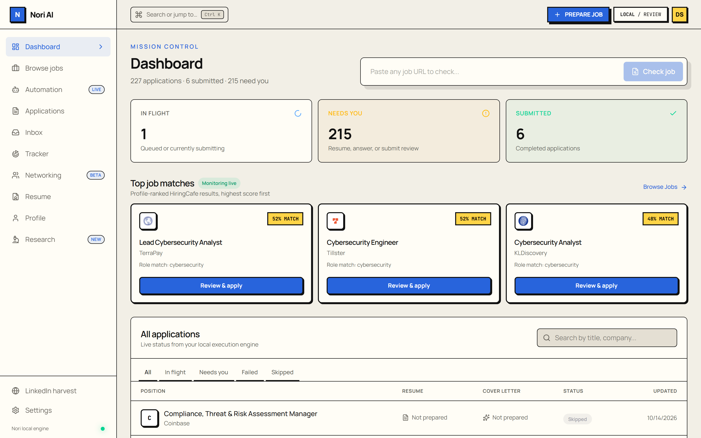
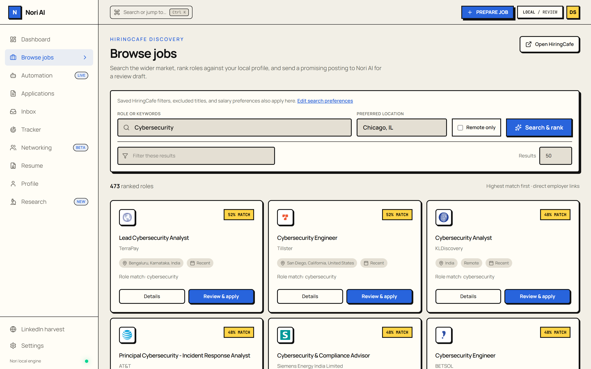
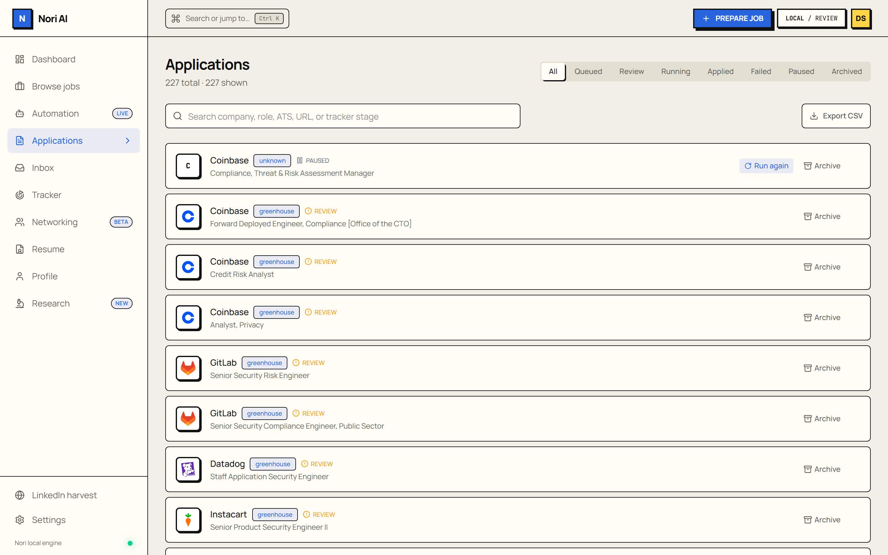
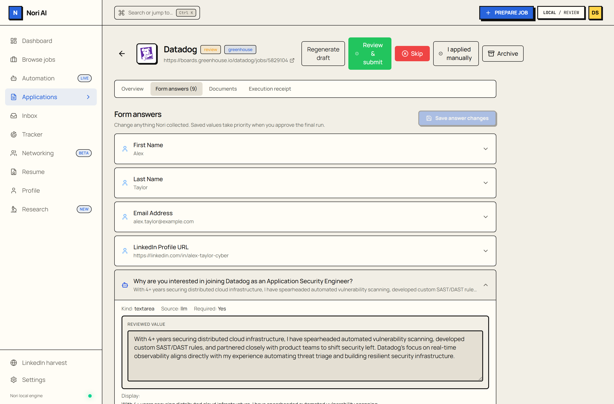
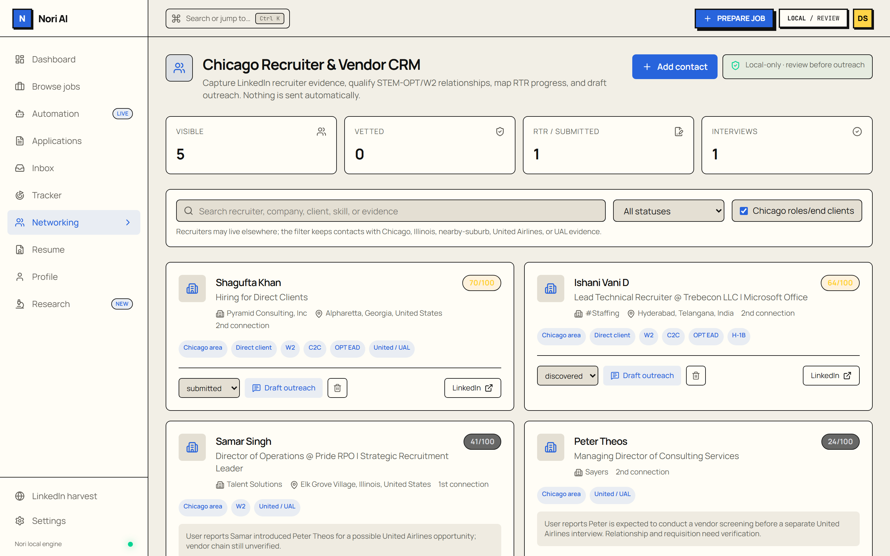
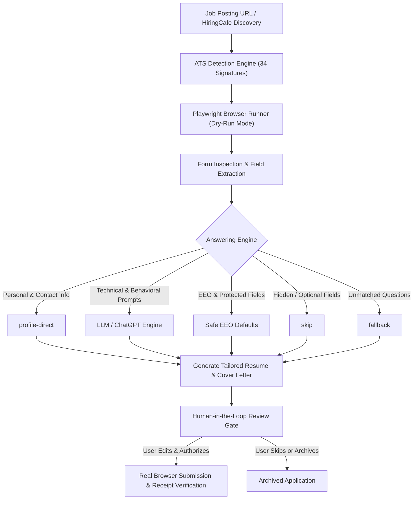

# Nori AI — Autonomous Local Job-Application Copilot

<div align="center">


<p align="center">
  <strong>A standalone, privacy-first job application copilot with deep ATS automation, intelligent job discovery, grounded LLM question-answering, and a strict human-in-the-loop review gate.</strong>
</p>

</div>

---

## Overview

**Nori AI** is a fully local, autonomous job-application copilot engineered for software engineers, cybersecurity analysts, and tech professionals. It handles the exhausting mechanics of job hunting—searching across hundreds of thousands of postings via HiringCafe, fingerprinting career portals across 34 applicant tracking systems (ATS), walking complex multi-step application wizards with Playwright, tailoring resumes and cover letters to job descriptions, and drafting grounded screening answers—**while enforcing an uncompromising human-in-the-loop review gate before any real application is ever submitted**.

- **100% Local-First & Private**: Runs entirely on your machine via FastAPI and a React 19 SPA. Your personal info, resumes, answers, browser cookies, and API keys never touch any external telemetry or proprietary backend.
- **Human-in-the-Loop Safety**: Real submissions require explicit candidate authorization. Applications pause at the `review` state, allowing you to audit, edit, or override any answer inline.
- **Enterprise-Grade ATS Compatibility**: 34 dedicated ATS adapters handle dynamic React forms, custom dropdowns, shadow DOMs, iframe embeddings, and multi-page application flows.
- **Grounded, Honest Answering**: Answers are categorized with explicit source attribution (`profile-direct`, `llm`, `fallback`, `skip`) to prevent hallucinations or embellishments.

---

## Mission Control


*Nori AI Mission Control — Real-time overview of active job matches, application statuses, and pending review actions.*

---

## Key Features

### 🛡️ Human-in-the-Loop Review Gate
Never submit blindly. Nori navigates the application form in dry-run mode, fills candidate details and answers questions locally, and pauses at the `review` state. You inspect every answer, edit anything inline, and authorize the final submission with one click.

### 🎯 34 Native ATS Adapters
Purpose-built form-walking engines for **Greenhouse, Lever, Workday, Ashby, SmartRecruiters, iCIMS, BambooHR, Dayforce, Paylocity, Bullhorn**, and 24 other platforms. Nori seamlessly navigates complex multi-stage wizards, custom selects, iframe portals, and candidate accounts.

### 🔍 Integrated HiringCafe Job Discovery
Direct semantic search across 500,000+ live jobs. Evaluates job descriptions against your local profile with transparent skill scoring, salary range matching, and constraint warnings (clearance, citizenship, experience gaps).

### 🤖 Attributed Question Answering
Every question answered during form filling is explicitly tagged by source:
- **`profile-direct`**: Identity, links, contact details, and work authorization directly from your profile.
- **`llm`**: High-context, thoughtful answers to open-ended technical and behavioral prompts tailored to your actual background.
- **`fallback`**: Safe, honest placeholders (*"Please refer to my resume..."*) for unanswerable fields.
- **`skip`**: Hidden, conditional, or optional questions intentionally left blank.

### 📄 Tailored Resume & Cover Letter Generation
Synthesizes job-aligned PDF resumes and cover letters using local or configured LLMs without hallucinating credentials or making unverified claims.

### 🔒 Zero Phone-Home Privacy
Runs 100% locally with FastAPI and a modern React 19 SPA. No third-party servers, no analytics, no subscription locks.

---

## Visual Tour

### 1. Intelligent Job Discovery & Match Ranking
Search the wider market, filter by role, location, salary, and remote preferences, and rank roles against your local profile with explainable matching criteria and requirement warnings.



---

### 2. Multi-ATS Application Pipeline
Track every active application with live ATS identification, status badges (`Queued`, `Running`, `Review`, `Applied`, `Paused`, `Failed`), company logos, and quick actions.



---

### 3. Human-in-the-Loop Review Gate & Form Answers
Inspect every filled form field before final submission. See the exact answering source (`profile-direct`, `llm`, `fallback`), edit values inline, and authorize real submission with explicit confirmation.



---

### 4. Recruiter & Vendor Networking CRM
Manage recruiter contacts from public searches, track Right-to-Represent (RTR) submissions, qualify W2 / C2C / OPT-EAD relationships, and draft personalized outreach messages.



---

## Architecture & Execution Flow



---

## Supported ATS Platforms (34 Certified)

| ATS Platform | Mode | Special Handling & Capabilities |
|---|---|---|
| **Greenhouse** | Full Walker | Normalizes embed/job URLs, parses custom questions, captures confirmation receipts |
| **Lever / Lever EU** | Full Walker | Canonical apply links, multi-section forms, structured receipt extraction |
| **Workday** | Full Walker | Dynamic career wizards, iframe traversal, account handoff, custom select menus |
| **Ashby** | Full Walker | System-field mapping, dynamic React form hydration, Ashby-specific receipt validation |
| **SmartRecruiters** | Full Walker | OneClick apply flow, closed-job detection, DataDome human verification gates |
| **iCIMS** | Full Walker | Nested portal iframes, multi-stage candidate forms, privacy gate handoff |
| **Dayforce** | Full Walker | Guest applicant flow, compact field IDs, focused form preprocessing |
| **Paylocity** | Full Walker | Upload-first resume parsing, labeled screening questions, 4-step wizard navigation |
| **BambooHR** | Full Walker | Posting modals, custom state/country select menus, closed-job detection |
| **Workable** | Full Walker | Canonical `/apply/` routing, candidate identity forms, strict receipt confirmation |
| **Rippling** | Full Walker | Delayed location autocomplete handling, single-page application form walker |
| **Jobvite** | Full Walker | Data consent pause, multi-page application forms, closed-job handling |
| **Breezy HR** | Full Walker | Public `/apply` resolution, question normalization, confirmation receipt capture |
| **Recruitee** | Full Walker | Hydrated React forms, `/c/new` route canonicalization, strict receipt validation |
| **Teamtailor** | Full Walker | Application overlay scoping, privacy-review preservation, confirmation receipts |
| **BrassRing** | Full Walker | External applicant routing, explicit privacy-review gates, session continuation |
| **ADP (Workforce Now / MyJobs)** | Full Walker | Candidate account checkpoints, conservative cookie preservation, receipt validation |
| **Paycom** | Full Walker | Legacy-to-modern job routing, guest identity preflight, multi-step continuation |
| **SAP SuccessFactors** | Full Walker | Classic and branded career portals, tenant account checkpoints, closed-posting checks |
| **Zoho Recruit** | Full Walker | Public form routing, non-essential cookie decline, consent-safe review fields |
| **UKG Pro / UltiPro** | Full Walker | Opportunity routing, candidate sign-in checkpoints, closed-posting detection |
| **Avature** | Full Walker | Branded career routing, guest resume-first flow, cross-ATS redirect handoff |
| **Pinpoint** | Full Walker | Lazy React-select handling, radio/question labeling, cookie rejection |
| **Phenom** | Full Walker | Branded job routing, native multi-stage form normalization, CAPTCHA review gates |
| **Hireology** | Full Walker | Accountless forms, label/required normalization, privacy-safe SMS defaults |
| **JOIN** | Full Walker | Public job routing, hidden form discrimination, email/magic-link checkpoint handoff |
| **Dover** | Full Walker | UUID question labeling, parser-vs-attachment resume handling, Turnstile gates |
| **Gem** | Full Walker | Hosted form routing, sponsorship grouping, voluntary-EEO preservation |
| **Polymer** | Full Walker | Inline form routing, custom question normalization, Cloudflare checkpoint handling |
| **Indeed** | Full Walker | Canonicalization, hosted-vs-employer routing, account/browser checkpoints |
| **Oracle Cloud CX** | Full Walker | Candidate Experience normalization, email-first preflight, consent gates |
| **Bullhorn** | API Adapter | Official Public REST API validation, read-only open/public preflight, guarded transport |
| **Naukri** | Safety Adapter | Closed/challenge/account detection; guarded to prevent unintended 1-click submit |
| **Generic ATS** | Fallback Walker | Conservative HTML-form discovery for unlisted career portals |

---

## Quickstart

### Prerequisites

- **Python 3.11+**
- **Node.js 20+** (only if rebuilding the frontend; pre-compiled static assets are included)
- **Git**

### Installation

```bash
# 1. Clone the repository
git clone https://github.com/dru5ud0/Nori.git
cd Nori

# 2. Create and activate a Python virtual environment
python -m venv .venv

# Windows
.\.venv\Scripts\Activate.ps1
# macOS / Linux
# source .venv/bin/activate

# 3. Install Python dependencies and Playwright browser
pip install -e ".[dev]"
playwright install chromium

# 4. Initialize your local candidate profile
cp loot/state/profile.example.json loot/state/profile.json
```

### Launching the Webapp

#### On Windows:
Double-click `start-nori-ai.cmd` or run:
```powershell
.\start-nori-ai.cmd
```

#### On Any Platform (Manual):
```bash
python -m uvicorn webapp.server:app --host 127.0.0.1 --port 8000
```

Open your browser at **`http://localhost:8000`** to access the Nori AI Mission Control workspace.

---

## Command Line Interface (CLI)

Nori includes a comprehensive CLI (`tsenta-cli`) for headless workflows and automated batch operations:

```bash
# Fetch job feed from public ATS career boards
tsenta-cli feed greenhouse:datadog --save

# One-shot application preparation: walks form, answers questions, stops at review
tsenta-cli quick https://boards.greenhouse.io/datadog/jobs/5829104

# Sweep over a saved feed up to a batch limit
tsenta-cli sweep loot/state/feed.json --limit 5

# View status of an application
tsenta-cli status <application-id>

# Generate full execution report (trace + sources + documents)
tsenta-cli report <application-id>

# Authorize real submission (the ONLY path that sends candidate data to the ATS)
tsenta-cli approve <application-id>
```

---

## Testing & Quality Assurance

The core engine is backed by a comprehensive offline test suite covering detection signatures, form walkers, document synthesis, and review-gate state machines:

```bash
# Run all 903 offline unit and integration tests
.\.venv\Scripts\python.exe -m pytest backend/tests

# Run live smoke tests against public ATS career boards (optional)
$env:LIVE = "1"; .\.venv\Scripts\python.exe -m pytest backend/tests -m live
```

```text
======================= 903 passed, 4 warnings in 28.42s =======================
```

---

## Safety & Ethics Principles

- **Zero Blind Submissions**: Every job application requires your explicit review and authorization. Nori will never submit an application in the background without human sign-off.
- **No CAPTCHA / Bot-Challenge Bypass**: Nori respects security gates. When an employer site presents a CAPTCHA or Cloudflare Turnstile challenge, Nori safely pauses and hands control to you in the browser.
- **Truthful Candidate Representation**: Answering models are strictly constrained by your local profile. Questions requiring unverified claims or certifications trigger explicit fallback notices rather than generated falsehoods.
- **EEO & Protected Data Safeguards**: Demographic and voluntary EEO questions default to privacy-preserving options (*"Decline to self-identify"* or blank) unless explicitly configured otherwise.

---

## Tech Stack

- **Backend**: Python 3.12, FastAPI, Playwright, Patchright, Uvicorn, Pydantic
- **Frontend**: React 19, TypeScript 6, Vite 8, Tailwind CSS 4, TanStack Query, Radix UI Primitives, Lucide Icons, Sonner
- **Storage**: Local JSON store with atomic file locking (`.lock`) and session persistence
- **Intelligence**: OpenAI-compatible LLM endpoints, local ChatGPT/Codex CLI integration, and heuristic rule engines

---

## License

This project is licensed under the [MIT License](LICENSE).
